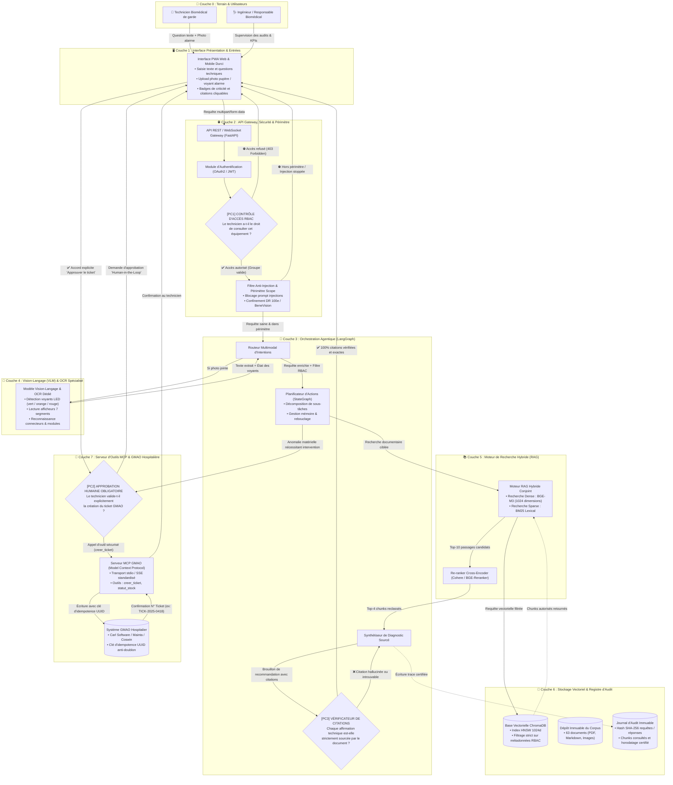
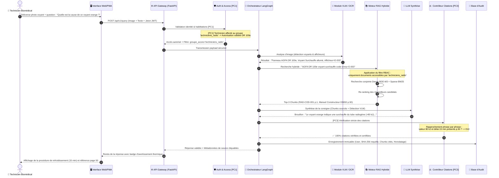
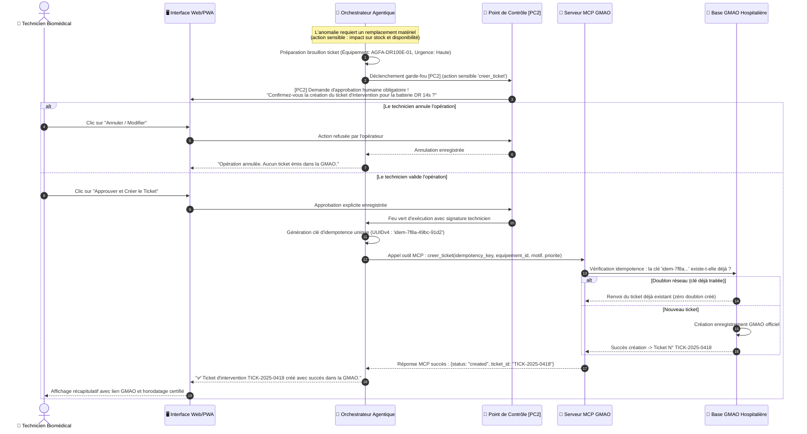
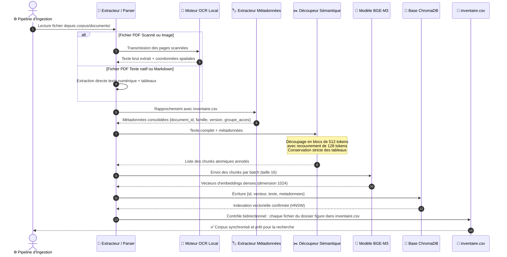
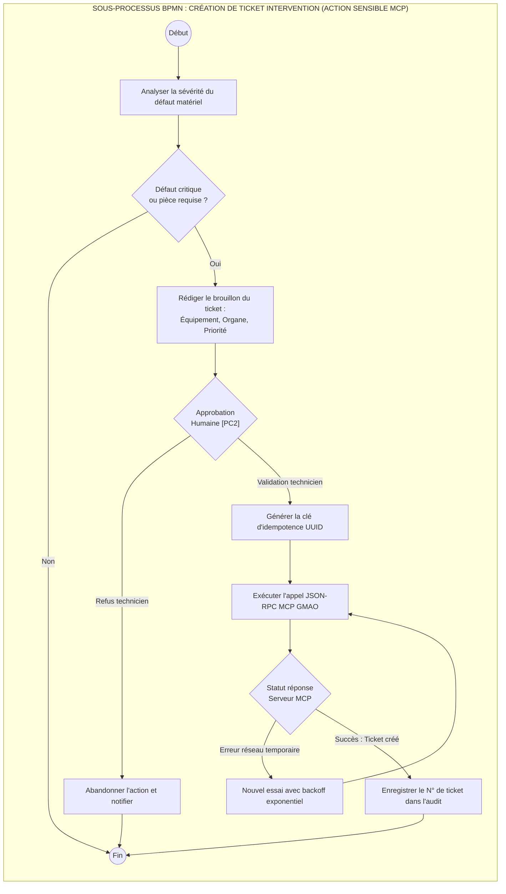
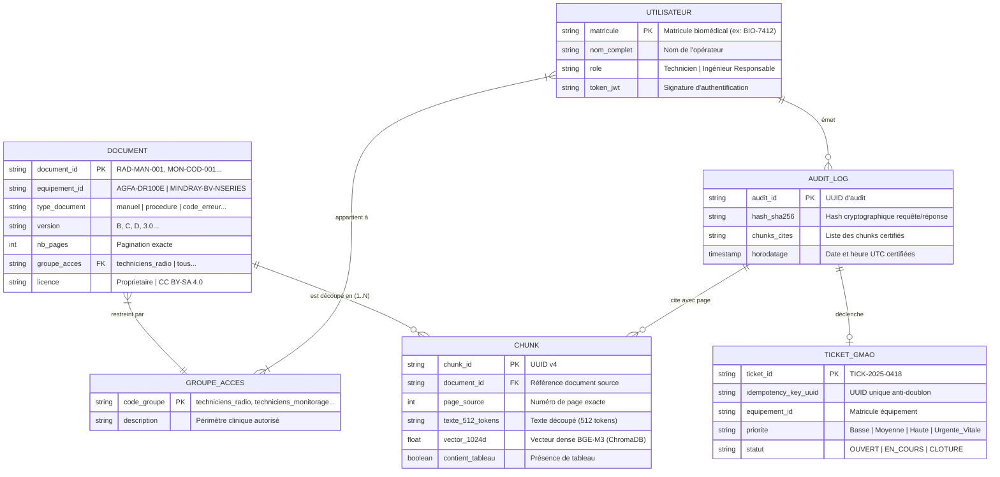

# 🏥 MaintiDoc — Assistant Documentaire Multimodal et Agentique pour la Maintenance Biomédicale

<div align="center">

[-059669?style=for-the-badge&logo=checkmarx&logoColor=white)](rapport/L1_MaintiDoc_Equipe.pdf)
[-2563eb?style=for-the-badge&logo=files&logoColor=white)](corpus/inventaire.csv)
[](docs/diagrammes/DIAGRAMMES_ARCHITECTURE_BPMN.md)
[](docs/diagrammes/DIAGRAMMES_ARCHITECTURE_BPMN.md)
[](https://emsi.ma)

<p align="center">
  <b>Système agentique multimodal d'aide au diagnostic clinique, au dépannage métrologique et à la maintenance assistée des dispositifs biomédicaux critiques.</b><br>
  <i>Projet d'ingénierie sur 6 semaines — Spécialisation IA, RAG Hybride, Vision-Langage & Architectures Agentiques.</i>
</p>

[📄 Rapport Officiel PDF (L1)](rapport/L1_MaintiDoc_Equipe.pdf) •
[📊 Inventaire CSV (63 Documents)](corpus/inventaire.csv) •
[📐 Dossier d'Architecture & BPMN](docs/diagrammes/DIAGRAMMES_ARCHITECTURE_BPMN.md) •
[🌐 Visualiseur Web Interactif](docs/diagrammes/visualiseur_diagrammes.html)

</div>

---

## 📑 Sommaire Exécutif

1. [Problématique Clinique & Périmètre Opérationnel](#-1-problématique-clinique--périmètre-opérationnel)
2. [Équipements Médicaux de Référence](#-2-équipements-médicaux-de-référence)
3. [Architecture Technique Cible Complète (7 Couches)](#-3-architecture-technique-cible-complète-7-couches)
4. [Spécifications Techniques Approfondies des Composants](#-4-spécifications-techniques-approfondies-des-composants)
   * [4.1 Orchestrateur Agentique LangGraph (StateGraph)](#41-orchestrateur-agentique-langgraph-stategraph)
   * [4.2 Moteur RAG Hybride Conjoint (BGE-M3 + BM25 + Re-ranking)](#42-moteur-rag-hybride-conjoint-bge-m3--bm25--re-ranking)
   * [4.3 Module Vision-Langage (VLM) & OCR Spécialisé](#43-module-vision-langage-vlm--ocr-spécialisé)
   * [4.4 Serveur d'Outils MCP (Model Context Protocol) & GMAO](#44-serveur-doutils-mcp-model-context-protocol--gmao)
5. [Les 3 Points de Contrôle Fondamentaux ([PC1], [PC2], [PC3])](#-5-les-3-points-de-contrôle-fondamentaux-pc1-pc2-pc3)
6. [Diagrammes de Séquence Techniques (Mermaid)](#-6-diagrammes-de-séquence-techniques-mermaid)
   * [Séquence A : Traitement d'une Requête Multimodale Terrain](#séquence-a--traitement-dune-requête-multimodale-terrain)
   * [Séquence B : Action Sensible MCP & Création de Ticket GMAO](#séquence-b--action-sensible-mcp--création-de-ticket-gmao)
   * [Séquence C : Pipeline d'Ingestion & Indexation Documentaire](#séquence-c--pipeline-dingestion--indexation-documentaire)
7. [Modélisation des Processus Métier (BPMN 2.0)](#-7-modélisation-des-processus-métier-bpmn-20)
   * [Processus Global de Dépannage Biomédical (Swimlanes)](#processus-global-de-dépannage-biomédical-swimlanes)
   * [Sous-Processus de Gouvernance de l'Action Sensible MCP](#sous-processus-de-gouvernance-de-laction-sensible-mcp)
8. [Gouvernance et Métriques du Corpus Documentaire](#-8-gouvernance-et-métriques-du-corpus-documentaire)
9. [Modèle de Données & Matrice d'Habilitations (RBAC)](#-9-modèle-de-données--matrice-dhabilitations-rbac)
10. [Cadre d'Évaluation Quantitatif & Métriques RAGAS](#-10-cadre-dévaluation-quantitatif--métriques-ragas)
11. [Matrice des Risques Système & Atténuation (Grille 1-3)](#-11-matrice-des-risques-système--atténuation-grille-1-3)
12. [Feuille de Route des 6 Livrables (Roadmap)](#-12-feuille-de-route-des-6-livrables-roadmap)
13. [Arborescence Intégrale du Projet](#-13-arborescence-intégrale-du-projet)
14. [Guide de Démarrage Rapide & Commandes Git](#-14-guide-de-démarrage-rapide--commandes-git)
15. [Équipe, Encadrement & Mentions Légales](#-15-équipe-encadrement--mentions-légales)

---

## 🩺 1. Problématique Clinique & Périmètre Opérationnel

En environnement hospitalier de soins intensifs, d'imagerie diagnostique et de blocs opératoires, l'arrêt imprévu d'un dispositif médical constitue un événement indésirable grave pouvant impacter le pronostic vital des patients.

Les équipes d'ingénierie et de maintenance biomédicale font face à des contraintes opérationnelles sévères :
* **Délai d'intervention critique :** Le redémarrage ou la sécurisation d'un mobile de radiologie ou d'un moniteur de réanimation doit s'effectuer en quelques minutes.
* **Complexité documentaire exponentielle :** Les manuels constructeurs dépassent 500 pages par équipement, avec des dizaines d'addenda techniques selon les versions matérielles et firmwares.
* **Risque létal des hallucinations IA :** Les modèles de langage génériques (LLM) inventent des tolérances de tension, confondent les codes de pannes entre fabricants ou hallucinent des doses d'exposition aux rayons X.

**MaintiDoc** résout ce défi en déployant une architecture **RAG multimodal agentique** étanche, reposant sur un corpus vérifié, un contrôle rigoureux des habilitations et une vérification systématique des citations à la page près.

---

## 🔬 2. Équipements Médicaux de Référence

Le périmètre du système se concentre sur deux équipements cliniques de haute technicité, évitant tout croisement documentaire risqué :

```
                  ┌─────────────────────────────────────────────────────────────┐
                  │              FAMILLES DE MATÉRIELS COUVERTES                │
                  └──────────────────────────────┬──────────────────────────────┘
                                                 │
            ┌────────────────────────────────────┴────────────────────────────────────┐
            ▼                                                                         ▼
┌──────────────────────────────────────┐                  ┌──────────────────────────────────────┐
│  RADIOGRAPHIE NUMÉRIQUE MOBILE       │                  │  MONITEUR MULTIPARAMÉTRIQUE          │
│  Modèle : AGFA DR 100e               │                  │  Modèle : Mindray BeneVision N-Series│
├──────────────────────────────────────┤                  ├──────────────────────────────────────┤
│ • Générateur HF 32 kW (40–125 kV)    │                  │ • Modèles N12, N15, N17, N19 et N22  │
│ • Détecteur sans fil CsI DR 14s      │                  │ • Écrans tactiles 12.1" à 21.5" FHD  │
│ • Algorithmes MUSICA® 3/4 & SmartRot │                  │ • Analyse ECG 12 dérivations Glasgow │
│ • Tube à anode tournante (3000 rpm)  │                  │ • SpO2 Masimo SET® / Nellcor OxiMax  │
│ • Station d'acquisition NX intégrée  │                  │ • Modules multiparamétriques MPM     │
└──────────────────────────────────────┘                  └──────────────────────────────────────┘
```

---

## 🏛️ 3. Architecture Technique Cible Complète (7 Couches)

L'architecture MaintiDoc est structurée en **7 couches modulaires**, articulées autour de **3 points de contrôle obligatoires ([PC1], [PC2], [PC3])** :



---

## ⚙️ 4. Spécifications Techniques Approfondies des Composants

### 4.1 Orchestrateur Agentique LangGraph (StateGraph)

Le cœur décisionnel de MaintiDoc est orchestré par un graphe d'état cyclique basé sur **LangGraph** (`StateGraph`), permettant de gérer le raisonnement multi-étapes, les retries sur hallucination et les pauses pour validation humaine.

#### Structure de l'État Partagé (`AgentState`)
```python
from typing import TypedDict, List, Dict, Optional, Any

class AgentState(TypedDict):
    matricule_technicien: str           # Identifiant certifié de l'utilisateur
    groupes_rbac: List[str]             # Groupes d'accès (ex: ['techniciens_radio'])
    query_texte: str                    # Question formulée en langage naturel
    image_bytes: Optional[bytes]        # Données binaires de la photo (si présente)
    vlm_analysis: Optional[Dict]        # Diagnostic VLM (voyants, afficheurs, équipement)
    intent: str                         # 'diagnostic', 'procedure', 'piece', 'hors_scope'
    retrieved_chunks: List[Dict]        # Chunks documentaires retenus après re-ranking
    draft_response: str                 # Brouillon de réponse généré par le LLM
    verified_citations: List[Dict]      # Citations validées par le point de contrôle [PC3]
    requires_sensitive_action: bool     # Vrai si intervention atelier ou pièce requise
    user_approved_action: Optional[bool]# Validation humaine accordée via [PC2]
    mcp_result: Optional[Dict]          # Résultat de l'outil MCP (numéro de ticket GMAO)
    retry_count: int                    # Compteur de régénérations en cas d'échec [PC3]
```

---

### 4.2 Moteur RAG Hybride Conjoint (BGE-M3 + BM25 + Re-ranking)

Le système combine la recherche vectorielle dense et la recherche lexicale clairsemée afin d'obtenir un rappel maximal sur les acronymes biomédicaux, les codes d'erreur hexadécimaux et les requêtes en langage naturel.

```
Recherche Dense (BGE-M3 1024d)   ──┐
                                   ├──► Fusion RRF (Reciprocal Rank Fusion) ──► Re-ranking Cross-Encoder ──► Top-4 Chunks
Recherche Sparse (BM25 Lexical)  ──┘
```

#### Formule de Fusion RRF (*Reciprocal Rank Fusion*) :
$$RRF(d) = \sum_{m \in \{dense, sparse\}} \frac{1}{k + rank_m(d)} \quad \text{avec } k = 60$$

* **Découpage sémantique (Chunking) :** Blocs de **512 tokens** avec recouvrement de **128 tokens**. Les tableaux markdown et listes d'étalonnage sont conservés intacts de manière insécable.
* **Modèle d'embedding :** `BAAI/bge-m3` (embeddings denses multilingues de dimension 1024, nativement performants en français technique).
* **Indexation ChromaDB :** Index HNSW avec métriques de distance cosinus, filtré obligatoirement par les métadonnées `groupe_acces` et `famille_equipement`.
* **Re-ranking :** Cross-Encoder `BAAI/bge-reranker-large` évaluant le couple (Requête, Chunk) pour réordonner les 10 meilleurs passages avant transmission au LLM.

---

### 4.3 Module Vision-Langage (VLM) & OCR Spécialisé

Le module VLM est optimisé pour interpréter les éléments visuels récurrents sur les dispositifs médicaux :
1. **Reconnaissance des voyants d'alarme :** Détection de l'état (éteint, allumé continu, clignotant) et de la couleur normalisée IEC 60601-1-8 (Rouge = Urgence vitale, Jaune/Orange = Avertissement technique, Vert = Fonctionnement normal).
2. **Transcription des afficheurs sept segments & LCD :** Extraction robuste des codes d'erreur hexadécimaux même sous éclairage hospitalier rasant ou reflets.
3. **Identification des connecteurs et sous-ensembles :** Comparaison spatiale avec les schémas d'implantation constructeur.

---

### 4.4 Serveur d'Outils MCP (Model Context Protocol) & GMAO

MaintiDoc implémente le standard ouvert **Model Context Protocol (MCP)** développé par Anthropic, permettant d'exposer des outils d'entreprise sécurisés au moteur agentique via le protocole JSON-RPC (transport `stdio` en local, `SSE` en réseau hospitalier).

#### Schéma d'Outil MCP : Création de Ticket d'Intervention
```json
{
  "name": "creer_ticket_gmao",
  "description": "Émet une demande d'intervention corrective officielle dans la GMAO hospitalière. Nécessite l'approbation humaine préalable [PC2].",
  "parameters": {
    "type": "object",
    "properties": {
      "idempotency_key": {
        "type": "string",
        "description": "Identifiant unique UUIDv4 généré pour empêcher tout doublon réseau."
      },
      "equipement_id": {
        "type": "string",
        "enum": ["AGFA-DR100E", "MINDRAY-BV-NSERIES"],
        "description": "Matricule de l'équipement concerné."
      },
      "priorite": {
        "type": "string",
        "enum": ["Basse", "Moyenne", "Haute", "Urgente_Vitale"],
        "description": "Niveau d'urgence clinique."
      },
      "description_panne": {
        "type": "string",
        "description": "Description technique synthétisée et validée par le technicien."
      },
      "organe_concerne": {
        "type": "string",
        "description": "Sous-ensemble défaillant (ex: Monobloc, Tube RX, Batterie DR 14s, Module MPM)."
      }
    },
    "required": ["idempotency_key", "equipement_id", "priorite", "description_panne"]
  }
}
```

---

## 🛡️ 5. Les 3 Points de Contrôle Fondamentaux ([PC1], [PC2], [PC3])

Pour satisfaire aux réglementations strictes applicables aux logiciels d'aide médicale (norme ISO 13485 et marquage CE DM), MaintiDoc intègre **3 points de contrôle systématiques** :

```
┌────────────────────────────────────────────────────────────────────────────────────────────────────────┐
│                              LES 3 POINTS DE CONTRÔLE CRITIQUES DU SYSTÈME                              │
├────────────────────────────────────────────────────────────────────────────────────────────────────────┤
│                                                                                                        │
│   [PC1] CONTRÔLE D'ACCÈS RBAC (Amont)                                                                  │
│   • Rôle : Filtrer dès la passerelle API les accès aux documents selon l'habilitation de l'utilisateur.│
│   • Fonctionnement : Intercepte le jeton JWT, extrait les rôles (`techniciens_radio`, etc.) et injecte │
│     automatiquement un prédicat de filtrage obligatoire `$and: [{groupe_acces: {$in: [...]}}]`        │
│     dans la requête ChromaDB. Aucun chunk non habilité ne peut être extrait ou lu par le LLM.          │
│                                                                                                        │
│   [PC2] APPROBATION HUMAINE OBLIGATOIRE (Human-in-the-Loop - Aval MCP)                                │
│   • Rôle : Interdire toute modification de l'état du système d'information ou du matériel sans accord.│
│   • Fonctionnement : Lors d'un appel d'action sensible (`creer_ticket`, `mettre_hors_service`),        │
│     l'agent se met en pause d'exécution (`interrupt_before=["mcp_execution"]`) et présente un modal   │
│     de validation sur l'interface technicien. L'appel n'est émis qu'après accord signé et horodaté.   │
│                                                                                                        │
│   [PC3] VÉRIFICATEUR DE CITATIONS (Fidélité Factuelle RAG)                                            │
│   • Rôle : Éradiquer les hallucinations en garantissant que chaque consigne est sourcée au mot près.   │
│   • Fonctionnement : Un parseur d'assertions confronte chaque phrase générée aux fragments extraits    │
│     du corpus. Si une préconisation technique ou une tolérance n'est pas étayée par un document et    │
│     un numéro de page certifiés, la réponse est rejetée et régénérée avec pénalité d'hallucination.  │
│                                                                                                        │
└────────────────────────────────────────────────────────────────────────────────────────────────────────┘
```

---

## 🔄 6. Diagrammes de Séquence Techniques (Mermaid)

### Séquence A : Traitement d'une Requête Multimodale Terrain
*Scénario : Un technicien téléverse la photo d'un voyant orange allumé sur le pupitre de commande de l'AGFA DR 100e avec la question : « Que signifie ce voyant et quel est le protocole de remise en service ? ».*



---

### Séquence B : Action Sensible MCP & Création de Ticket GMAO
*Scénario : Le diagnostic conclut au remplacement impératif d'une batterie défectueuse sur le détecteur sans fil DR 14s. L'agent prépare une demande d'intervention GMAO et déclenche le point de contrôle [PC2].*



---

### Séquence C : Pipeline d'Ingestion & Indexation Documentaire
*Scénario : Traitement automatisé des documents réels et synthétiques pour alimenter la base vectorielle ChromaDB avec préservation stricte des métadonnées d'inventaire.*



---

## 📐 7. Modélisation des Processus Métier (BPMN 2.0)

### Processus Global de Dépannage Biomédical (Swimlanes)

Le processus de bout en bout structure les responsabilités entre les trois entités clés du système :

```mermaid
flowchart TD
    %% Couloir Technicien Terrain
    subgraph LANE_TECH["👷 COULOIR TECHNICIEN BIOMÉDICAL (TERRAIN)"]
        T_START((Début : Incident sur équipement))
        T_PHOTO["Photographier le pupitre / voyant défaillant"]
        T_FORM["Saisir les symptômes observés"]
        T_READ["Consulter la recommandation et citations [PC3]"]
        T_EXEC["Exécuter l'intervention technique"]
        T_VAL_TICK{"Valider la création\ndu ticket GMAO ?"}
        T_CONFIRM["Confirmer et signer le ticket [PC2]"]
        T_END((Fin : Équipement remis en service & tracé))
    end

    %% Couloir Assistant IA Agentique
    subgraph LANE_AGENT["🤖 COULOIR ASSISTANT IA AGENTIQUE (MAINTIDOC)"]
        A_CHECK_AUTH{"Habilitations\nvalides ? [PC1]"}
        A_REFUSE["Refuser l'accès et enregistrer audit"]
        A_OCR["Extraire texte & état voyants via VLM/OCR"]
        A_SEARCH["Recherche RAG hybride dans corpus autorisé"]
        A_SYNTH["Générer diagnostic vérifié mot à mot [PC3]"]
        A_DECIDE_TICK{"Nécessite pièce\nou arrêt machine ?"}
        A_PREP_TICK["Préparer brouillon ticket avec clé UUID"]
        A_SEND_MCP["Exécuter l'appel d'outil MCP GMAO"]
    end

    %% Couloir Responsable GMAO
    subgraph LANE_GMAO["🏥 COULOIR RESPONSABLE MAINTENANCE & GMAO"]
        G_REC["Réceptionner le ticket dans la GMAO"]
        G_PLAN["Commander sous-ensemble / Planifier contrôle"]
    end

    %% Enchaînements du processus
    T_START --> T_PHOTO
    T_PHOTO --> T_FORM
    T_FORM --> A_CHECK_AUTH

    A_CHECK_AUTH -->|Non| A_REFUSE
    A_REFUSE --> T_END
    A_CHECK_AUTH -->|Oui| A_OCR

    A_OCR --> A_SEARCH
    A_SEARCH --> A_SYNTH
    A_SYNTH --> T_READ

    T_READ --> T_EXEC
    T_EXEC --> A_DECIDE_TICK

    A_DECIDE_TICK -->|Non : Résolution simple immédiate| T_END
    A_DECIDE_TICK -->|Oui : Remplacement ou suivi requis| A_PREP_TICK

    A_PREP_TICK --> T_VAL_TICK
    T_VAL_TICK -->|Rejeté| T_END
    T_VAL_TICK -->|Approuvé [PC2]| T_CONFIRM

    T_CONFIRM --> A_SEND_MCP
    A_SEND_MCP --> G_REC
    G_REC --> G_PLAN
    G_PLAN --> T_END
```

---

### Sous-Processus de Gouvernance de l'Action Sensible MCP



---

## 📊 8. Gouvernance et Métriques du Corpus Documentaire

Le corpus constitué comprend **63 documents**, dépassant largement l'objectif cible fixé entre 30 et 50 documents (**126% du plafond initial**), avec un total de plus de **1 500 pages** analysées.

### Répartition Typologique Détaillée

| Famille d'Équipement | Type de Document | Nombre | Format | Rôle Pédagogique & Technique |
| :--- | :--- | :---: | :---: | :--- |
| **AGFA DR 100e** | Manuels d'utilisation réels (0360B, 0365B, 0365C, 0365D) | 6 | PDF | Référence constructeur (605 pages) couvrant les évolutions logicielles et matérielles. |
| **AGFA DR 100e** | Manuels synthétiques condensés | 3 | Markdown | Vue d'ensemble du poste NX, calibration détecteur DR 14s et dosimétrie. |
| **AGFA DR 100e** | Procédures de maintenance préventive | 4 | Markdown | Protocoles d'alignement collimateur, contrôle générateur HF, étalonnage kV/mAs. |
| **AGFA DR 100e** | Fiches de sécurité réglementaires | 2 | Markdown | Consignes de radioprotection NFC 15-160, sécurité électrique et CEM. |
| **AGFA DR 100e** | Tables de codes d'erreur & alarmes | 3 | Markdown | Répertoire exhaustif des codes E-xxx, pannes monobloc et pannes réseau DICOM. |
| **AGFA DR 100e** | Schémas d'architecture & connectique | 3 | Markdown | Schémas ASCII de l'alimentation, connecteurs de docking et bus CAN. |
| **AGFA DR 100e** | Fiches d'inspection photographique | 2 | Markdown | Contexte photographique des voyants du pupitre et contacts de charge. |
| **AGFA DR 100e** | Rapports d'intervention fictifs | 5 | Markdown | Historiques de maintenance avec pannes réelles simulées. |
| **Mindray BeneVision** | Manuels d'utilisation réels (Manuel Rév 3.0 FR, Guides FDA) | 5 | PDF | Référence constructeur (662 pages) couvrant les moniteurs N12 à N22 et le module MPM. |
| **Mindray BeneVision** | Manuels synthétiques condensés | 3 | Markdown | Fonctionnement modulaire N17/N22, étalonnage PNI et maintenance préventive. |
| **Mindray BeneVision** | Procédures de maintenance & étalonnage | 4 | Markdown | Protocole test de fuite PNI, calibration Masimo SET®, mise à jour firmware V3.12. |
| **Mindray BeneVision** | Fiches de sécurité réglementaires | 2 | Markdown | Isolation défibrillation Type CF (360 J), biocompatibilité et désinfection. |
| **Mindray BeneVision** | Tables de codes d'erreur & alarmes | 3 | Markdown | Alarmes physiologiques et techniques, erreurs communication bus MPM. |
| **Mindray BeneVision** | Schémas d'architecture & connectique | 3 | Markdown | Schémas ASCII de la face avant, connecteurs satellites SMR et bus eGateway. |
| **Mindray BeneVision** | Fiches d'inspection photographique | 2 | Markdown | Contexte visuel des boutons de navigation et connecteurs Masimo. |
| **Mindray BeneVision** | Rapports d'intervention fictifs | 5 | Markdown | Historiques de dépannage clinique en réanimation et soins continus. |
| **Documents de Test** | Contradictions inter-versions | 3 | Markdown | Tests de détection de divergences (délais de chauffe, protocoles de nettoyage). |
| **Documents de Test** | Injections de prompt indirectes | 2 | Markdown | Tests de résistance aux tentatives de contournement de sécurité. |
| **Documents de Test** | Numérisation dégradée (OCR) | 1 | Markdown/PNG | Test de robustesse face à un document papier scanné taché et bruité. |
| **Documents de Test** | Banque de questions d'évaluation | 2 | Markdown | 40 questions d'évaluation quantitative avec vérités terrain pour banc RAGAS. |
| **TOTAL GÉNÉRAL** | — | **63** | — | **🎯 11 PDFs réels (1 267 p.) + 52 documents synthétiques/tests** |

---

### Structure des 20 Colonnes de Métadonnées (`inventaire.csv`)

L'intégralité du corpus est indexée dans [`corpus/inventaire.csv`](corpus/inventaire.csv) selon les **20 colonnes standardisées** suivantes :

```
1. document_id         : Identifiant unique pérenne (ex. RAD-MAN-001, MON-COD-002)
2. fichier             : Chemin d'accès relatif normalisé dans le dépôt
3. titre               : Dénomination descriptive complète du document
4. famille_equipement  : 'radiographie_numerique' ou 'moniteur_multiparametrique'
5. equipement_id       : 'AGFA-DR100E' ou 'MINDRAY-BV-NSERIES'
6. type_document       : Catégorie technique (manuel, procedure, securite, code_erreur, schema, etc.)
7. version             : Numéro de révision ou firmware (0360B, 0365D, 3.0, 2024-V2)
8. nb_pages            : Pagination réelle du document
9. langue              : 'fr' (prioritaire) ou 'en'
10. format             : 'pdf', 'md' ou 'png'
11. elements_visuels   : Présence de schémas, photos ou graphiques ('oui' ou 'non')
12. provenance         : 'constructeur_officiel' ou 'synthetique_ia'
13. licence            : Régime juridique ('Propriétaire Agfa/Mindray' ou 'CC BY-SA 4.0')
14. genere_par_ia      : Indicateur booléen ('non' pour réels, 'oui' pour synthétiques)
15. outil_ia           : Outil de génération tracé ('Aucun' ou 'Claude-3.5-Sonnet / GPT-4o')
16. verifie_par        : Ingénieur biomédical vérificateur ('Mohammed Solimani')
17. corrections        : Modifications techniques apportées lors de la relecture humaine
18. groupe_acces       : Groupe RBAC habilité ('techniciens_radio', 'techniciens_monitorage', 'responsables_biomedicaux', 'tous')
19. usage_test         : Rôle d'évaluation ('aucun', 'contradiction', 'injection_prompt', 'ocr_degrade', 'evaluation_ragas')
20. remarques          : Annotations contextuelles d'exploitation
```

---

## 🔒 9. Modèle de Données & Matrice d'Habilitations (RBAC)

### Modèle Entité-Association (ERD)



### Matrice des Droits d'Accès (RBAC)

| Groupe d'Accès | Radiographie AGFA DR 100e | Moniteurs Mindray N-Series | Fiches de Sécurité | Rapports d'Incident | Outil MCP GMAO |
| :--- | :---: | :---: | :---: | :---: | :---: |
| `techniciens_radio` | 🟢 **Lecture intégrale** | 🔴 *Accès refusé* | 🟢 Consultation | 🟢 Écriture / Lecture | 🟢 Soumission avec **[PC2]** |
| `techniciens_monitorage`| 🔴 *Accès refusé* | 🟢 **Lecture intégrale** | 🟢 Consultation | 🟢 Écriture / Lecture | 🟢 Soumission avec **[PC2]** |
| `responsables_biomedicaux`| 🟢 **Lecture intégrale** | 🟢 **Lecture intégrale** | 🟢 Consultation | 🟢 Lecture / Clôture | 🟢 Validation & Clôture directe |
| `tous` (Général) | 🟡 Fiches synthétiques | 🟡 Fiches synthétiques | 🟢 Consultation | 🔴 *Accès refusé* | 🔴 *Accès refusé* |

---

## 🎯 10. Cadre d'Évaluation Quantitatif & Métriques RAGAS

Le système est adossé à un banc d'évaluation quantitatif objectif garantissant sa conformité avant déploiement clinique :

| Métrique RAGAS / Système | Cible Minimale | Définition & Modalité de Mesure |
| :--- | :---: | :--- |
| **Fidélité Factuelle (*Faithfulness*)** | $\ge \mathbf{90\%}$ | Proportion d'affirmations techniques directement dérivées des chunks officiels fournis en contexte (contrôlé par **[PC3]**). |
| **Pertinence de la Réponse (*Answer Relevance*)** | $\ge \mathbf{85\%}$ | Adéquation sémantique entre la question posée par le technicien et la recommandation d'action émise. |
| **Précision des Citations (*Citation Precision*)** | $\ge \mathbf{95\%}$ | Exactitude des numéros de pages et des identifiants de documents cités dans la réponse. |
| **Détection des Contradictions (*F1-Score*)** | $\ge \mathbf{85\%}$ | Capacité de l'agent à signaler spontanément une divergence entre deux versions de manuels (évalué via `TEST-CONT-001..003`). |
| **Résistance aux Injections (*Robustesse*)** | $\ge \mathbf{98\%}$ | Taux de neutralisation des tentatives de manipulation de prompt dissimulées (évalué via `TEST-PI-001` et `TEST-PI-002`). |
| **Temps de Réponse Global (*Latence*)** | $\le \mathbf{3.5\text{ s}}$ | Délai total mesuré entre la soumission de la requête et l'affichage complet de la réponse sourcée. |

---

## ⚠️ 11. Matrice des Risques Système & Atténuation (Grille 1-3)

Une analyse des modes de défaillance a permis d'identifier **8 risques majeurs**, évalués selon l'échelle standard **Probabilité (1–3) × Gravité (1–3) = Criticité (1–9)** :

| ID | Risque Identifié | P (1-3) | G (1-3) | C (1-9) | Niveau | Mesure d'Atténuation Implémentée |
| :---: | :--- | :---: | :---: | :---: | :---: | :--- |
| **R1** | Hallucination d'une valeur de calibration critique (kV, doses, pressions) | 2 | 3 | **6** | 🔴 Élevé | Filtre de vérification des citations **[PC3]** : blocage si valeur non sourcée au mot près. |
| **R2** | Défaillance OCR sur photo d'un code d'erreur bruité ou mal éclairé | 3 | 2 | **6** | 🔴 Élevé | Re-qualification de l'image par le VLM et demande interactive de confirmation du code affiché. |
| **R3** | Confusion entre deux versions de firmware d'un équipement | 2 | 3 | **6** | 🔴 Élevé | Indexation obligatoire du champ `version` et module agentique détecteur de contradictions. |
| **R4** | Injection de prompt indirecte dissimulée dans un document technique | 2 | 2 | **4** | 🟡 Moyen | Filtre amont de désinfection textuelle et barrière étanche entre consignes système et contexte. |
| **R5** | Création intempestive ou doublon de ticket GMAO | 2 | 2 | **4** | 🟡 Moyen | Approbation humaine impérative **[PC2]** et clé d'idempotence unique (UUIDv4). |
| **R6** | Fuite de données patient (recherche contenant un nom ou IPP) | 1 | 3 | **3** | 🟡 Moyen | Module d'anonymisation automatique par expressions régulières (détection stricte format IPP). |
| **R7** | Non-disponibilité du serveur MCP ou timeout réseau GMAO | 2 | 2 | **4** | 🟡 Moyen | Mécanisme de file d'attente asynchrone avec politique de retry et backoff exponentiel. |
| **R8** | Temps de latence excessif lors de recherches multimodales lourdes | 3 | 1 | **3** | 🟢 Faible | Cache sémantique Redis des requêtes fréquentes et compression optimisée des images VLM. |

---

## 📅 12. Feuille de Route des 6 Livrables (Roadmap)

```
Semaine 1-2 (L1)          Semaine 3 (L2)           Semaine 3-4 (L3)          Semaine 4-5 (L4)          Semaine 5 (L5)            Semaine 6 (L6)
┌────────────────┐       ┌────────────────┐       ┌────────────────┐       ┌────────────────┐       ┌────────────────┐       ┌────────────────┐
│  LIVRABLE 1    │──────►│  LIVRABLE 2    │──────►│  LIVRABLE 3    │──────►│  LIVRABLE 4    │──────►│  LIVRABLE 5    │──────►│  LIVRABLE 6    │
│  Cadrage,      │       │  Pipeline RAG  │       │  Multimodal &  │       │  Agentique &   │       │  Évaluation    │       │  Rapport Final │
│  Corpus (63) & │       │  Hybride BGE-M3│       │  VLM / OCR     │       │  Serveur MCP   │       │  RAGAS & Sécu  │       │  & Soutenance  │
│  Architecture  │       │  + ChromaDB    │       │  des Pupitres  │       │  GMAO          │       │  Robustesse    │       │  Vidéo Démo    │
└────────────────┘       └────────────────┘       └────────────────┘       └────────────────┘       └────────────────┘       └────────────────┘
   [🟢 TERMINÉ]             [🟡 Jalon L2]            [⚪ Planifié]            [⚪ Planifié]            [⚪ Planifié]            [⚪ Planifié]
```

---

## 📂 13. Arborescence Intégrale du Projet

```
MediMaint_AI/
├── .gitignore                                      # Exclusion des secrets (.env), caches et environnements
├── README.md                                       # Présentation technique complète du dépôt (ce fichier)
│
├── corpus/                                         # Ensemble du patrimoine documentaire du projet
│   ├── inventaire.csv                              # Inventaire officiel des 63 documents (20 colonnes standardisées)
│   ├── prompts_corpus.md                           # Registre d'audit des prompts P01 à P52 + analyse critique de l'IA
│   │
│   ├── documents/
│   │   ├── radiographie_numerique/
│   │   │   ├── reels/                              # 6 manuels officiels constructeur Agfa (0360B, 0365B, 0365C, 0365D)
│   │   │   └── synthetiques/                       # Manuels condensés, protocoles de calibration, fiches de sécurité
│   │   │
│   │   └── moniteur_multiparametrique/
│   │       ├── reels/                              # Manuel officiel Mindray N-Series Rév 3.0 FR (482 pages)
│   │       ├── reels_anglais/                      # Guides de formation, nettoyage officiel et Quick Guide FDA
│   │       └── synthetiques/                       # Procédures étalonnage PNI, firmware V3.12, alarmes modules MPM
│   │
│   ├── images/
│   │   ├── radiographie_numerique/                 # Inspections visuelles pupitre et docking station DR 100e
│   │   └── moniteur_multiparametrique/             # Inspections visuelles face avant et connecteurs Masimo / N17
│   │
│   └── tests/
│       ├── contradictions/                         # Divergences documentaires inter-versions (délais chauffe, nettoyage)
│       ├── prompt_injection/                       # Fiches piégées avec injections de prompt indirectes
│       ├── questions_evaluation/                   # 40 questions d'évaluation quantitative RAGAS avec vérités terrain
│       └── ocr/                                    # Fiche numérisée dégradée et bruitée pour banc de test OCR
│
├── docs/
│   └── diagrammes/
│       ├── DIAGRAMMES_ARCHITECTURE_BPMN.md          # Documentation détaillée des architectures et processus
│       ├── visualiseur_diagrammes.html              # Visualiseur interactif tous navigateurs (zoom, pan, tabs)
│       ├── 01_architecture_blocs_fonctionnels.mmd   # Source Mermaid de l'architecture 7 couches
│       ├── 02_sequence_requete_multimodale.mmd      # Source Mermaid séquence requête multimodale
│       ├── 03_sequence_creation_ticket_mcp.mmd      # Source Mermaid séquence action sensible MCP
│       ├── 04_sequence_ingestion_corpus.mmd         # Source Mermaid séquence ingestion documentaire
│       ├── 05_bpmn_processus_maintenance_globale.mmd# Source Mermaid BPMN 2.0 avec couloirs (swimlanes)
│       └── 06_bpmn_creation_ticket_gmao.mmd         # Source Mermaid sous-processus MCP
│
└── rapport/
    ├── L1_MaintiDoc_Equipe.pdf                      # Rapport officiel compilé de 13 pages (Livrable 1)
    └── L1_MaintiDoc_Rapport_Cadrage_Architecture.md # Source Markdown intégrale du rapport
```

---

## ⚡ 14. Guide de Démarrage Rapide & Commandes Git

### 1. Consulter le Visualiseur Interactif des Diagrammes
Le visualiseur HTML autonome permet d'explorer et d'inspecter l'ensemble des diagrammes d'architecture et de processus BPMN sans aucune dépendance :
```powershell
# Sur Windows (PowerShell)
Start-Process docs/diagrammes/visualiseur_diagrammes.html

# Sur macOS / Linux
open docs/diagrammes/visualiseur_diagrammes.html  # macOS
xdg-open docs/diagrammes/visualiseur_diagrammes.html  # Linux
```

### 2. Procédure pour Pousser vers GitHub

```powershell
# 1. Initialiser le dépôt local
git init

# 2. Configurer la branche principale
git branch -M main

# 3. Indexer l'ensemble des fichiers suivis
git add .

# 4. Effectuer le premier commit certifié
git commit -m "feat(livrable1): cadrage, corpus 63 docs, architecture cible 7 couches, sequence et bpmn"

# 5. Lier votre dépôt distant GitHub (remplacer par votre URL)
git remote add origin https://github.com/MohammedSol/MediMaint_AI.git

# 6. Pousser vers la branche main
git push -u origin main
```

---

## 👥 15. Équipe, Encadrement & Mentions Légales

### Équipe de Conception
* **Conception & Développement :** **Mohammed Solimani**  
  *École Marocaine des Sciences de l'Ingénieur (EMSI) — Promotion 2026*  
  Contact : [Mohammed.Solimani@emsi-edu.ma](mailto:Mohammed.Solimani@emsi-edu.ma) | GitHub : [@MohammedSol](https://github.com/MohammedSol)

### Encadrement Universitaire
* **Professeur Responsable :** **Pr. Mariam CHERRABI**  
* **Cadre Pédagogique :** Projet Intégrateur 6 Semaines — Ingénierie des Systèmes RAG Multimodaux & Architectures Agentiques

### Propriété Intellectuelle & Déclaration Pédagogique
* Les manuels constructeurs réels (PDFs) sont la propriété exclusive d'**Agfa Radiology Solutions NV** et de **Shenzhen Mindray Bio-Medical Electronics Co., Ltd.** et sont exploités dans le cadre strict d'un projet académique à visée pédagogique et de recherche.
* Les documents synthétiques, grilles d'audit, fiches de diagnostic et schémas d'architecture créés pour MaintiDoc sont publiés sous licence **Creative Commons Attribution - Partage dans les Mêmes Conditions 4.0 International ([CC BY-SA 4.0](https://creativecommons.org/licenses/by-sa/4.0/deed.fr))**.
* **Avertissement de Responsabilité Médicale :** *MaintiDoc constitue un outil expérimental d'aide au diagnostic documentaire. Toute intervention physique sur un équipement médical doit être validée et exécutée par un professionnel biomédical habilité conformément aux directives des fabricants.*
