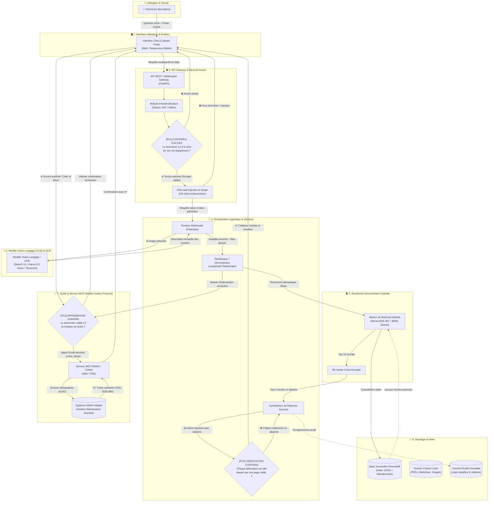
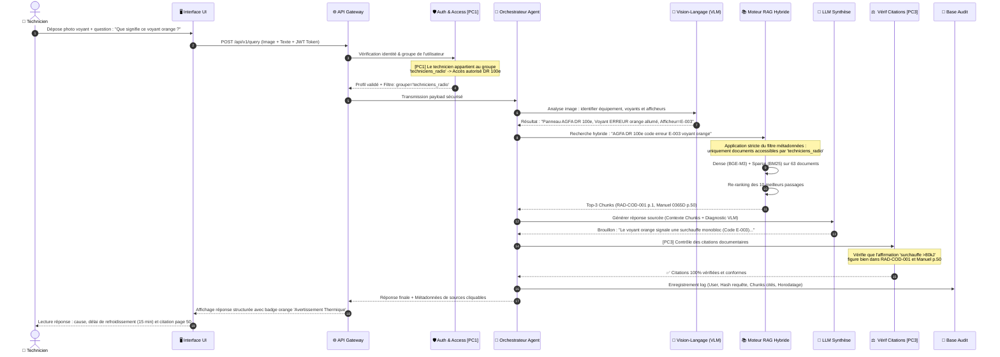
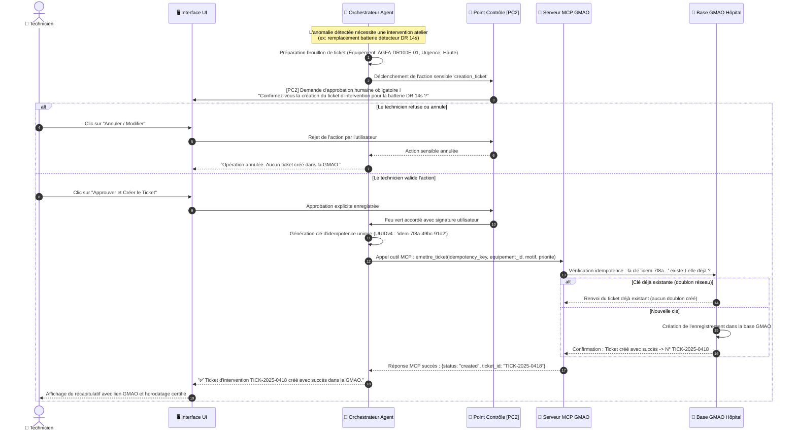
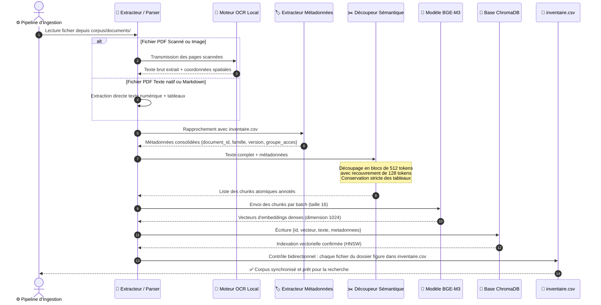

# Dossier des Diagrammes d'Architecture, Séquences et BPMN — Projet MaintiDoc

> **Module :** IA Générative Multimodale — EMSI 2026  
> **Projet :** MaintiDoc — Assistant documentaire multimodal et agentique pour la maintenance biomédicale  
> **Enseignante :** Prof-MariamCHERRABI  
> **Auteur :** Mohammed Solimani  
> **Répertoire :** `docs/diagrammes/`  

---

## Sommaire des Diagrammes

1. [Architecture Cible par Blocs Fonctionnels (avec Points de Contrôle)](#1-architecture-cible-par-blocs-fonctionnels)
2. [Fiches Techniques par Bloc](#2-fiches-techniques-par-bloc-fonctionnel)
3. [Diagramme de Séquence 1 : Parcours d'une Requête Multimodale (Photo de Voyant)](#3-diagramme-de-séquence-1--requête-multimodale-photo-de-voyant)
4. [Diagramme de Séquence 2 : Action Sensible MCP — Création de Ticket d'Intervention](#4-diagramme-de-séquence-2--action-sensible-mcp--création-de-ticket)
5. [Diagramme de Séquence 3 : Flux d'Ingestion et Indexation du Corpus](#5-diagramme-de-séquence-3--flux-dingestion-et-indexation)
6. [Diagramme BPMN 1 : Processus Métier Global de Maintenance Assistée par IA](#6-diagramme-bpmn-1--processus-métier-global-de-maintenance)
7. [Diagramme BPMN 2 : Processus BPMN de Création de Ticket Sécurisé via MCP](#7-diagramme-bpmn-2--processus-bpmn-de-création-de-ticket-mcp)
8. [Schéma des Métadonnées et Modèle de Contrôle d'Accès](#8-schéma-des-métadonnées-et-modèle-de-contrôle-daccès)

---

## 1. Architecture Cible par Blocs Fonctionnels

Ce schéma présente l'ensemble des modules du système, la nature des flux échangés et **l'emplacement précis des 3 points de contrôle exigés par les consignes** :
- **[PC1] Contrôle des droits d'accès :** Vérifie l'identité du technicien et filtre les documents autorisés avant toute recherche.
- **[PC2] Validation et approbation humaine :** Empêche toute action sensible (ex: création de ticket de maintenance GMAO) sans consentement explicite de l'opérateur.
- **[PC3] Vérification des citations :** Contrôle que chaque affirmation de la réponse s'appuie sur une source existante et non hallucinée dans le corpus.



---

## 2. Fiches Techniques par Bloc Fonctionnel

Conformément aux consignes de la section 2.3 du livrable 1 :

### Bloc 1 : Interface Utilisateur (UI)
- **Rôle en une phrase :** Fournir aux techniciens une interface réactive et intuitive pour formuler des questions en langage naturel, téléverser des photographies de pupitres et visualiser les réponses sourcées.
- **Entrées :** Saisie texte de l'utilisateur, fichiers images (JPEG/PNG), clics d'approbation humaine.
- **Sorties :** Affichage de la réponse mise en forme (Markdown, badges de criticité, liens vers les pages des manuels), prévisualisation des tickets à valider.
- **Outil envisagé :** Interface Web Streamlit / Gradio pour le prototypage rapide, avec portage React/Tailwind pour mobile.

### Bloc 2 : API Gateway & Sécurité Amont
- **Rôle en une phrase :** Réceptionner les flux, authentifier le technicien, appliquer le contrôle d'accès par groupe d'équipement `[PC1]` et neutraliser les injections de prompt.
- **Entrées :** Requêtes HTTP multipart du client UI, en-têtes d'authentification JWT.
- **Sorties :** Objet requête validé, enrichi de l'identifiant utilisateur et du filtre de groupe d'accès autorisé.
- **Outil envisagé :** FastAPI avec Pydantic v2 et intergiciels de sécurité personnalisés.

### Bloc 3 : Orchestration Agentique & Décision
- **Rôle en une phrase :** Coordonner l'analyse d'intention, planifier la décomposition de la requête, déclencher les bons outils et vérifier la fidélité des citations avant restitution `[PC3]`.
- **Entrées :** Requête assainie, descriptions VLM, chunks documentaires, retours d'outils MCP.
- **Sorties :** Réponse finale étayée, ordre de demande d'approbation `[PC2]`, journal d'audit.
- **Outil envisagé :** LangGraph (StateGraph) pour une orchestration déterministe avec boucles de révision.

### Bloc 4 : Modèle Vision-Langage (VLM) & OCR
- **Rôle en une phrase :** Analyser visuellement les photographies d'écrans ou de voyants pour extraire l'état des témoins lumineux, les valeurs affichées et le contexte de l'équipement.
- **Entrées :** Images compressées (max 1920×1080), prompt guidé d'inspection visuelle.
- **Sorties :** Description structurée en JSON (ex: `{"voyant_alarme": "rouge_clignotant", "valeur_fc": "38 bpm", "code": "E-003"}`).
- **Outil envisagé :** Modèle multimodal local (Qwen2-VL-7B quantifié en GGUF 4-bit) ou fallback Tesseract OCR + LLM multimodal cloud.

### Bloc 5 : Recherche Documentaire Hybride (RAG)
- **Rôle en une phrase :** Identifier et extraire les passages, tableaux et schémas les plus pertinents parmi les seuls documents autorisés pour l'utilisateur.
- **Entrées :** Requête de recherche textuelle enrichie, filtre de métadonnées `{groupe_acces, famille_equipement}`.
- **Sorties :** Liste ordonnée de chunks documentaires avec identifiant de document, numéro de page et score de similarité.
- **Outil envisagé :** BAAI/bge-m3 pour les embeddings denses (1024 dimensions) + BM25 pour les codes exacts + BAAI/bge-reranker-large.

### Bloc 6 : Stockage & Index
- **Rôle en une phrase :** Héberger de manière persistante l'index vectoriel des documents, les fichiers originaux du corpus et les journaux immuables d'audit des interventions.
- **Entrées :** Vecteurs d'embeddings, métadonnées de documents, logs d'exécution.
- **Sorties :** Résultats de recherche vectorielle par k-plus proches voisins, documents sources.
- **Outil envisagé :** ChromaDB (vector store local persistant) + système de fichiers local / SQLite pour l'audit.

### Bloc 7 : Outil & Serveur MCP (Model Context Protocol)
- **Rôle en une phrase :** Interfacer de manière standardisée l'agent avec le système externe de GMAO hospitalière pour la consultation d'historiques et la création sécurisée de tickets sous approbation `[PC2]`.
- **Entrées :** Appels d'outils au format JSON-RPC (`consulter_historique`, `preparer_ticket`, `emettre_ticket`).
- **Sorties :** Comptes rendus d'interventions passées, numéro unique de ticket créé (`TICK-YYYY-XXXX`).
- **Outil envisagé :** SDK officiel Python MCP (`mcp-server-gmao`) avec protocole standard stdio.

---

## 3. Diagramme de Séquence 1 : Requête Multimodale (Photo de Voyant)

Ce diagramme détaille le parcours d'une requête soumise par un technicien avec une photographie d'un voyant orange sur le pupitre de l'AGFA DR 100e :



---

## 4. Diagramme de Séquence 2 : Action Sensible MCP — Création de Ticket

Ce diagramme modélise l'action sensible de création de ticket d'intervention dans la GMAO hospitalière, illustrant **l'approbation humaine `[PC2]` et l'idempotence** :



---

## 5. Diagramme de Séquence 3 : Flux d'Ingestion et Indexation

Ce diagramme montre comment un document (manuel PDF officiel ou fiche markdown synthétique) est transformé en vecteurs enrichis dans la base vectorielle ChromaDB :



---

## 6. Diagramme BPMN 1 : Processus Métier Global de Maintenance

Ce diagramme modélise le processus métier de bout en bout sous le standard international **BPMN 2.0 (Business Process Model and Notation)** avec trois couloirs de responsabilités (Swimlanes) :

```mermaid
flowchart TD
    %% Couloirs Swimlanes
    subgraph LANE_TECH["👷 COULOIR TECHNICIEN BIOMÉDICAL (TERRAIN)"]
        T_START((Début : Incident sur équipement))
        T_PHOTO[Photographier le pupitre / voyant défaillant]
        T_FORM[Saisir la description des symptômes]
        T_READ[Consulter le diagnostic et la procédure proposée]
        T_EXEC[Exécuter l'intervention sur la machine]
        T_VAL_TICK{Valider la création\ndu ticket GMAO ?}
        T_CONFIRM[Confirmer et signer la demande de ticket]
        T_END((Fin : Équipement dépanné & tracé))
    end

    subgraph LANE_AGENT["🤖 COULOIR ASSISTANT IA AGENTIQUE (MAINTIDOC)"]
        A_CHECK_AUTH{Droits d'accès\nvalides ? [PC1]}
        A_REFUSE[Refuser l'accès et notifier l'utilisateur]
        A_OCR[Extraire le texte et voyants via Vision/OCR]
        A_SEARCH[Rechercher les chunks dans le corpus autorisé]
        A_SYNTH[Générer la recommandation avec citations [PC3]]
        A_DECIDE_TICK{Nécessite une\npièce ou arrêt ?}
        A_PREP_TICK[Préparer le ticket GMAO avec idempotence]
        A_SEND_MCP[Appeler l'outil MCP GMAO]
    end

    subgraph LANE_GMAO["🏥 COULOIR RESPONSABLE MAINTENANCE & GMAO"]
        G_REC[Réceptionner le ticket dans la GMAO]
        G_PLAN[Commander la pièce détachée / Planifier suivi]
    end

    %% Enchaînements BPMN
    T_START --> T_PHOTO
    T_PHOTO --> T_FORM
    T_FORM --> A_CHECK_AUTH

    A_CHECK_AUTH -->|Non| A_REFUSE
    A_REFUSE --> T_END
    A_CHECK_AUTH -->|Oui| A_OCR

    A_OCR --> A_SEARCH
    A_SEARCH --> A_SYNTH
    A_SYNTH --> T_READ

    T_READ --> T_EXEC
    T_EXEC --> A_DECIDE_TICK

    A_DECIDE_TICK -->|Non : Dépannage simple achevé| T_END
    A_DECIDE_TICK -->|Oui : Pièce / intervention lourde| A_PREP_TICK

    A_PREP_TICK --> T_VAL_TICK
    T_VAL_TICK -->|Rejeté| T_END
    T_VAL_TICK -->|Approuvé [PC2]| T_CONFIRM

    T_CONFIRM --> A_SEND_MCP
    A_SEND_MCP --> G_REC
    G_REC --> G_PLAN
    G_PLAN --> T_END
```

---

## 7. Diagramme BPMN 2 : Processus BPMN de Création de Ticket MCP

Focus BPMN spécifique sur le sous-processus sécurisé de déclenchement d'un outil MCP sensible avec portes logiques et compensation :

```mermaid
flowchart LR
    subgraph BPMN_MCP["SOUS-PROCESSUS BPMN : CRÉATION DE TICKET INTERVENTION (ACTION SENSIBLE MCP)"]
        E_START((Début))
        P_ANALYSE[Analyser la sévérité du défaut matériel]
        GW_CRIT{Défaut critique\nou pièce requise ?}
        P_DRAFT[Rédiger le brouillon du ticket :\nÉquipement, Organe, Priorité]
        GW_HUMAN{Approbation\nHumaine [PC2]}
        P_CANCEL[Abandonner l'action et notifier]
        P_IDEM[Générer la clé d'idempotence UUID]
        P_CALL_MCP[Exécuter l'appel JSON-RPC MCP GMAO]
        GW_MCP_STAT{Statut réponse\nServeur MCP}
        P_RETRY[Nouvel essai avec backoff exponentiel]
        P_CONFIRM[Enregistrer le N° de ticket dans l'audit]
        E_END((Fin))
    end

    E_START --> P_ANALYSE --> GW_CRIT
    GW_CRIT -->|Non| E_END
    GW_CRIT -->|Oui| P_DRAFT --> GW_HUMAN
    GW_HUMAN -->|Refus technicien| P_CANCEL --> E_END
    GW_HUMAN -->|Validation technicien| P_IDEM --> P_CALL_MCP --> GW_MCP_STAT
    GW_MCP_STAT -->|Erreur réseau temporaire| P_RETRY --> P_CALL_MCP
    GW_MCP_STAT -->|Succès : Ticket créé| P_CONFIRM --> E_END
```

---

## 8. Schéma des Métadonnées et Modèle de Contrôle d'Accès

### 8.1 Structure d'un Élément Indexé (Chunk Metadata Schema)

Chaque fragment documentaire injecté dans ChromaDB est associé à la structure de données JSON suivante :

```json
{
  "chunk_id": "rad_man_001_c014",
  "document_id": "manuel_dr100e_digital_condense",
  "version": "0365D-2025 (2025-01)",
  "page": 50,
  "section": "4.2 Consignes impératives de sécurité",
  "type_element": "tableau_avertissements",
  "famille_equipement": "radiographie_numerique",
  "equipement_id": "AGFA-DR100E-01",
  "type_document": "manuel",
  "groupe_acces": ["techniciens_radio", "responsables"],
  "usage_test": "normal",
  "est_verifie": true
}
```

### 8.2 Modèle de Contrôle d'Accès par Rôles (RBAC)

Deux groupes d'utilisateurs fictifs principaux sont modélisés conformément aux exigences :

```
┌────────────────────────────────────────────────────────────────────────┐
│                      MODÈLE D'ACCÈS RBAC MAINTIDOC                     │
├────────────────────────────┬───────────────────────────────────────────┤
│ Groupe 1 :                 │ Autorisé UNIQUEMENT sur la famille        │
│ 'techniciens_radio'        │ 'radiographie_numerique' (AGFA DR 100e)   │
│                            │ ⛔ Bloqué sur moniteurs BeneVision        │
├────────────────────────────┼───────────────────────────────────────────┤
│ Groupe 2 :                 │ Autorisé UNIQUEMENT sur la famille        │
│ 'techniciens_moniteur'     │ 'moniteur_multiparametrique' (BeneVision) │
│                            │ ⛔ Bloqué sur radiographie AGFA DR 100e   │
├────────────────────────────┼───────────────────────────────────────────┤
│ Groupe 3 :                 │ Autorisé sur l'ENSEMBLE du corpus         │
│ 'responsables' (Biomédical)│ + Vue des fiches contradictoires & audits │
└────────────────────────────┴───────────────────────────────────────────┘
```

- **Règle de filtrage vectoriel obligatoire :**
  Lorsqu'une requête est émise par un membre du groupe `techniciens_radio`, la requête ChromaDB intègre automatiquement le filtre strict :
  `where={"groupe_acces": {"$contains": "techniciens_radio"}}`.
  Il est donc mathématiquement impossible pour ce technicien d'extraire un fragment du moniteur Mindray ou un document réservé aux ingénieurs responsables.

---
*Fin du document de spécification des diagrammes — Projet MaintiDoc 2025.*

