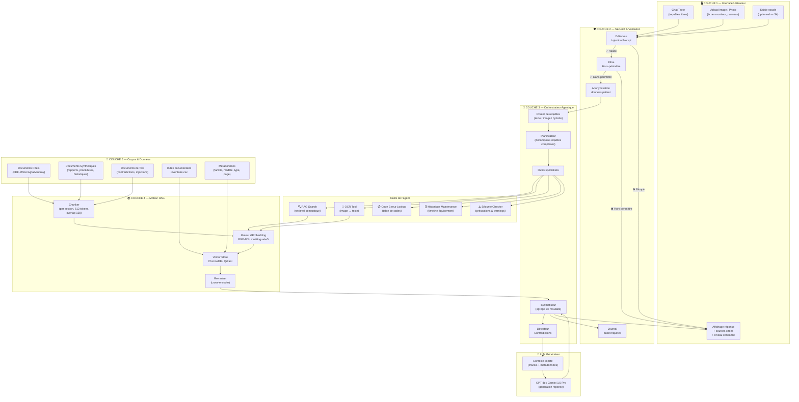
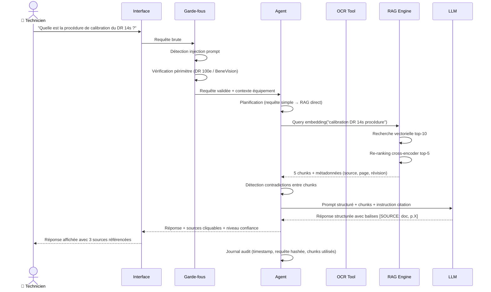
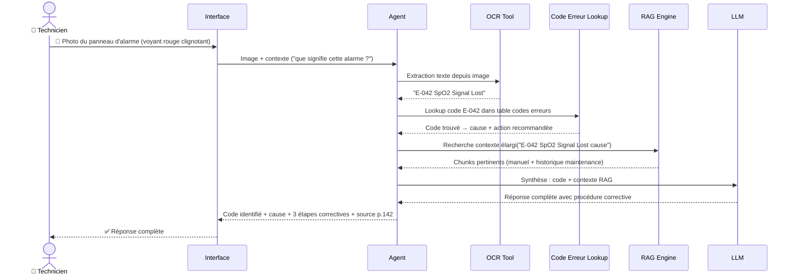
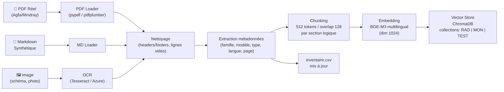

# MaintiDoc — Architecture du Système Agentique
## Conception Architecturale — Livrable 1

> **Rôle :** Architecte système  
> **Équipements :** AGFA DR 100e · Mindray BeneVision N-Series (N12/N15/N17/N19/N22)  
> **Date :** 2025-11-06 · **Révision :** 1.0

---

## 1. Vision Architecturale

MaintiDoc est un système **RAG agentique multimodal** à 5 couches, conçu pour répondre en langage naturel aux questions de techniciens biomédicaux sur leurs équipements, en s'appuyant sur un corpus documentaire vérifié.

### Principes directeurs

| Principe | Application |
|----------|-------------|
| **Vérifiabilité** | Toute réponse cite sa source documentaire avec numéro de page |
| **Sécurité patient** | Aucune information sur le patient n'est persistée |
| **Robustesse** | Détection des injections de prompt et des contradictions |
| **Traçabilité** | Chaque requête est journalisée avec sa chaîne de retrieval |
| **Domaine fermé** | L'agent refuse explicitement les requêtes hors-périmètre |

---

## 2. Architecture en Blocs (5 couches)

---

## 3. Parcours d'une Requête (Sequence Diagram)

---

## 4. Parcours d'une Requête Image (Photo d'un Panneau)

---

## 5. Flux de Données et Modèle d'Accès

### 5.1 Pipeline d'indexation (offline)

### 5.2 Modèle d'accès par rôle

| Rôle | Accès corpus | Fonctions autorisées |
|------|-------------|---------------------|
| **Technicien** | RAD + MON (docs vérifiés) | Consultation, historique propre équipement |
| **Ingénieur biomédical** | RAD + MON + TEST | Consultation + vue des contradictions détectées |
| **Administrateur** | Tout le corpus | Gestion inventaire, ajout/retrait documents |
| **Agent IA** | Corpus filtré par requête | RAG retrieval + lookup tables |

> [!IMPORTANT]
> Les documents de test (`tests/prompt_injection/`, `tests/contradictions/`) sont **exclus du corpus de production** et uniquement accessibles aux administrateurs pour évaluation.

### 5.3 Stratégie de chunking

| Type de document | Stratégie | Taille chunk |
|-----------------|-----------|-------------|
| Manuels utilisateur | Par section (H1/H2) | 512 tokens |
| Procédures maintenance | Par étape numérotée | 256 tokens |
| Codes d'erreur | Par code (1 chunk = 1 code) | 128 tokens |
| Rapports d'intervention | Par bloc sémantique | 384 tokens |
| Schémas illustrés | Texte alternatif + légende | 256 tokens |

---

## 6. Analyse des Risques (10 risques)

| # | Risque | Prob. | Impact | Criticité | Mitigation |
|---|--------|-------|--------|-----------|------------|
| **R01** | **Hallucination LLM** sur procédure critique (ex: tension kV incorrecte) | Moyenne | Critique | 🔴 Élevée | RAG strict (top-k faible) + disclaimer + citation obligatoire de source |
| **R02** | **Injection de prompt** dans le corpus (document piégé) | Faible | Élevé | 🟠 Moyenne | Scan préalable corpus + sandbox LLM + liste blanche des instructions système |
| **R03** | **Documents réels indisponibles** publiquement (licence restrictive) | Élevée | Élevé | 🟠 Moyenne | Corpus synthétique de substitution qualifié |
| **R04** | **OCR défaillant** sur documents scannés dégradés | Moyenne | Moyen | 🟡 Modérée | Prétraitement image (denoise, deskew) + seuil de confiance OCR |
| **R05** | **Données contradictoires** entre versions de manuel (ex: 0365B vs 0365D) | Élevée | Élevé | 🟠 Moyenne | Détecteur contradiction cross-chunks + alerte explicite dans réponse |
| **R06** | **Violation RGPD** : données patient dans une requête | Faible | Critique | 🟠 Moyenne | Anonymisation automatique (regex NER) + aucune persistance |
| **R07** | **Dérive hors-périmètre** : questions sur d'autres équipements | Moyenne | Faible | 🟢 Faible | Filtre domaine strict (liste blanche modèles) + rejet explicite |
| **R08** | **Latence excessive** (>5s) pour usage terrain sans réseau | Faible | Élevé | 🟡 Modérée | Cache embeddings + modèle local fallback (Ollama) |
| **R09** | **Document synthétique non vérifié** utilisé comme référence | Moyenne | Élevé | 🟠 Moyenne | Tag `verifie:false` → avertissement automatique dans la réponse |
| **R10** | **Mise à jour matériel** (nouveau firmware) rend corpus obsolète | Faible | Moyen | 🟢 Faible | Versionning documents + alertes révision dans inventaire |

---

## 7. Plan de Génération du Corpus (36+ documents)

### État cible du corpus

| Catégorie | Famille RAD | Famille MON | Total |
|-----------|------------|------------|-------|
| Manuels & documentation | 3 | 3 | **6** |
| Procédures de maintenance | 4 | 4 | **8** |
| Fiches de sécurité | 2 | 2 | **4** |
| Tables de codes d'erreur | 3 | 3 | **6** |
| Schémas illustrés (ASCII/SVG) | 3 | 3 | **6** |
| Photographies contextualisées | 2 | 2 | **4** |
| Documents de test | 3 | 3 | **6** |
| **Existants (SYN-001→005)** | 5 | 5 | **10** |
| **TOTAL** | **25** | **25** | **~50** |

### Nomenclature des nouveaux documents

**Manuels & documentation (RAD)**
- `RAD-MAN-001` Manuel utilisateur condensé DR 100e (digital) — inspiré 0365D
- `RAD-MAN-002` Guide de démarrage rapide DR 100e + DR 14s
- `RAD-MAN-003` Manuel d'utilisation DR 100e (Film/CR) — inspiré 0360B

**Manuels & documentation (MON)**
- `MON-MAN-001` Manuel utilisateur condensé BeneVision N17/N22 — inspiré FR 3.0
- `MON-MAN-002` Guide de référence rapide BeneVision N-Series
- `MON-MAN-003` Guide utilisateur avancé BeneVision (formation)

**Procédures de maintenance (RAD)**
- `RAD-PROC-001` Procédure maintenance préventive trimestrielle DR 100e
- `RAD-PROC-002` Procédure remplacement batterie détecteur DR 14s
- `RAD-PROC-003` Procédure contrôle qualité image (NUC + MTF)
- `RAD-PROC-004` Procédure remplacement tube à rayons X

**Procédures de maintenance (MON)**
- `MON-PROC-001` Procédure maintenance préventive trimestrielle BeneVision N-Series
- `MON-PROC-002` Procédure étalonnage PNI (pression non-invasive)
- `MON-PROC-003` Procédure mise à jour firmware (V3.0 → V3.12)
- `MON-PROC-004` Procédure remplacement batterie interne BeneVision

**Fiches de sécurité**
- `RAD-SEC-001` Fiche sécurité rayonnements ionisants — DR 100e
- `RAD-SEC-002` Fiche sécurité électrique et CEM — DR 100e
- `MON-SEC-001` Fiche sécurité alarmes et défaillances — BeneVision N-Series
- `MON-SEC-002` Fiche sécurité électrique et défibrillation — BeneVision

**Tables de codes d'erreur**
- `RAD-COD-001` Table codes erreurs générateur et exposition — DR 100e
- `RAD-COD-002` Table codes erreurs détecteur DR 14s (WiFi, batterie, capteur)
- `RAD-COD-003` Table messages d'état application NX Workstation
- `MON-COD-001` Table alarmes physiologiques — BeneVision N-Series
- `MON-COD-002` Table alarmes techniques — BeneVision N-Series
- `MON-COD-003` Table codes erreurs modules (ECG, SpO2, PNI, Temp)

**Schémas illustrés**
- `RAD-SCH-001` Schéma panneau de commandes générateur DR 100e (ASCII art)
- `RAD-SCH-002` Schéma connecteurs et ports réseau DR 100e
- `RAD-SCH-003` Schéma composants détecteur DR 14s (vue éclatée)
- `MON-SCH-001` Schéma face avant BeneVision N17/N22 (touches et connecteurs)
- `MON-SCH-002` Schéma modules et baies d'extension N-Series
- `MON-SCH-003` Schéma connexions capteurs (ECG, SpO2, PNI, Temp, IBP)

**Photographies contextualisées**
- `RAD-PHO-001` Description photographique panneau générateur DR 100e (voyants état)
- `RAD-PHO-002` Description photographique docking station DR 14s
- `MON-PHO-001` Description photographique face avant BeneVision N22 (voyants alarme)
- `MON-PHO-002` Description photographique connecteurs arrière BeneVision N17

**Documents de test (contradictions)**
- `TEST-CONT-002` Contradiction fréquence maintenance RAD (trimestrielle vs semestrielle)
- `TEST-CONT-003` Contradiction seuils alarme SpO2 MON (88% vs 90% vs 92%)
- `TEST-PI-002` Document piégé — fiche codes erreur MON avec injection cachée

**Cas de test complémentaires**
- `TEST-QEV-001` Questions d'évaluation RAG — famille radiographie (20 questions)
- `TEST-QEV-002` Questions d'évaluation RAG — famille moniteur (20 questions)
- `TEST-OCR-001` Document simulant un scan dégradé (texte brouillé, rotation)

