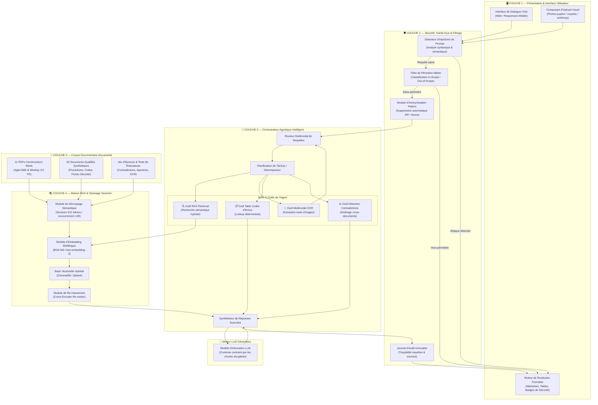
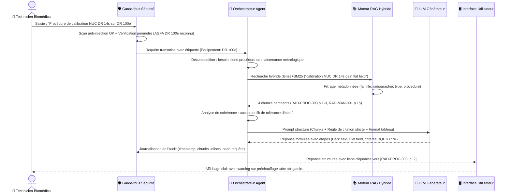
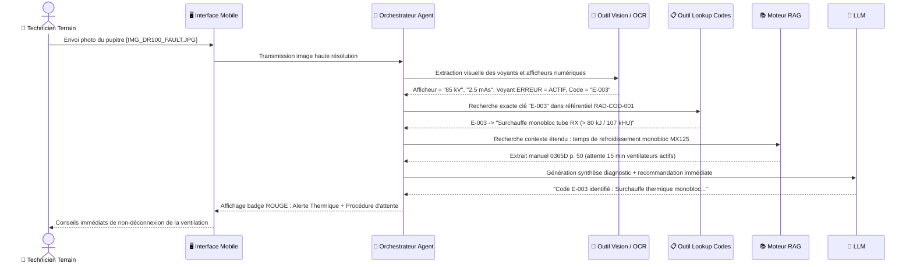
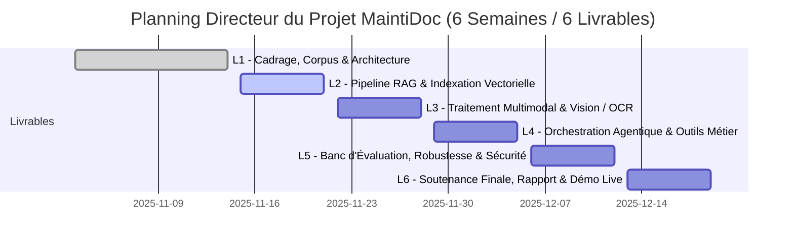

# MaintiDoc — Assistant Documentaire Multimodal et Agentique pour Techniciens de Maintenance Biomédicale

## Rapport du Livrable 1 : Cadrage, Constitution du Corpus et Architecture Cible du Système

---

### Informations Générales du Projet

- **Projet :** MaintiDoc (Assistant Biomédical Agentique)
- **Document :** Rapport de Cadrage et Conception Architecturale (Livrable 1)
- **Version :** 1.0 — Consolidation Finale
- **Date :** Novembre 2025
- **Familles d'équipements cibles :**
  1. *Radiographie numérique mobile :* **AGFA DR 100e** (avec détecteur sans fil Agfa DR 14s et logiciel NX Workstation)
  2. *Moniteur multiparamétrique de soins critiques :* **Mindray BeneVision N-Series** (modèles N12, N15, N17, N19 et N22)

---

## Sommaire Exécutif

Le projet **MaintiDoc** a pour vocation de concevoir et déployer un assistant documentaire intelligent, multimodal et agentique, destiné aux techniciens et ingénieurs biomédicaux intervenant en environnement hospitalier. Face à la complexité croissante des dispositifs médicaux, à la dispersion des manuels d'utilisation (souvent volumineux, atteignant 500 pages par équipement), aux mises à jour logicielles fréquentes et aux contraintes strictes de sécurité sanitaire, les équipes techniques sont confrontées à une charge cognitive élevée lors des dépannages d'urgence au chevet du patient ou des visites de maintenance préventive.

Ce premier livrable (L1) formalise les fondations conceptuelles, techniques et documentaires du système :
1. **Le cadrage opérationnel :** Définition des profils d'utilisateurs, cartographie des cas d'usage majeurs, métriques d'évaluation vérifiables et frontières strictes du périmètre (in-scope vs out-of-scope).
2. **La constitution et la qualification du corpus documentaire :** Constitution d'un fonds de **63 documents** (> 1 500 pages), combinant 11 manuels réels certifiés constructeurs (Agfa et Mindray) et 52 documents synthétiques qualifiés (procédures, fiches de sécurité, tables de codes d'erreur, schémas techniques, photographies d'atelier, et jeux d'évaluation).
3. **L'architecture cible agentique :** Modélisation en 5 couches fonctionnelles intégrant un orchestrateur d'agents, un pipeline RAG (Retrieval-Augmented Generation) hybride sémantique/mots-clés, des outils d'extraction OCR multimodale et des modules de détection d'anomalies.
4. **Les flux de données et la gouvernance d'accès :** Pipeline d'ingestion/chunking, politique de cloisonnement RBAC et protection absolue de la confidentialité patient (conformité RGPD / secret médical).
5. **L'analyse des risques biomédicaux et informatiques :** Évaluation approfondie de 10 risques critiques avec matrice d'impact et plans de mitigation opérationnels.
6. **Le planning directeur à 6 semaines et la gouvernance d'équipe :** Découpage en 6 jalons avec matrice de responsabilités RACI.

---

## 1. Cadrage du Projet

### 1.1 Utilisateurs et Personas Cibles

L'analyse du contexte hospitalier permet de distinguer trois profils d'utilisateurs principaux ayant des besoins d'assistance documentaire différenciés :

| Profil Utilisateur | Contexte d'intervention | Besoins documentaires clés | Contraintes opérationnelles |
| :--- | :--- | :--- | :--- |
| **Technicien Biomédical Terrain** | Intervention d'urgence en chambre de réanimation ou bloc opératoire | Identification instantanée des codes d'alarme, localisation des connecteurs, procédures de redémarrage sécurisé | Mains encombrées (port de gants), stress temporel, connectivité WiFi parfois dégradée |
| **Technicien de Maintenance Atelier** | Révision préventive trimestrielle, réparation au composant, recalibration | Grilles de tolérance métrologique, couples de serrage, protocoles NUC/MTF, références de pièces détachées | Besoin de précision documentaire absolue, recherche par numéros de pièces |
| **Ingénieur Biomédical / Responsable Sécurité** | Recette d'équipements neufs, matériovigilance, audits de conformité (ASN / HAS) | Déclarations de conformité DICOM/HL7, traçabilité des mises à jour micrologicielles, conformité aux normes CEI | Exhaustivité réglementaire, besoin d'historisation et de preuves auditables |

### 1.2 Cas d'Usage Principaux (Use Cases)

```
┌────────────────────────────────────────────────────────────────────────┐
│                      CAS D'USAGE MAJEURS MAINTIDOC                     │
├────────────────────────────────┬───────────────────────────────────────┤
│ UC-01 : Dépannage sur code     │ Saisie textuelle d'un code erreur     │
│         d'alarme ou d'anomalie │ (ex: "E-001" ou "AL-T06") -> Cause,   │
│                                │ niveau de gravité et action corrective│
├────────────────────────────────┼───────────────────────────────────────┤
│ UC-02 : Diagnostic visuel      │ Upload d'une photographie de pupitre  │
│         multimodal par image   │ ou d'écran -> OCR -> Analyse de       │
│                                │ voyants et proposition de conduite    │
├────────────────────────────────┼───────────────────────────────────────┤
│ UC-03 : Guidage pas-à-pas en   │ Restitution ordonnée des étapes d'une │
│         maintenance préventive │ procédure complexe (ex: calibration   │
│                                │ NUC DR 14s, étalonnage PNI manomètre) │
├────────────────────────────────┼───────────────────────────────────────┤
│ UC-04 : Requête métrologique   │ Recherche de valeurs seuils, tolérances│
│         et spécifications      │ de fuite, couples de serrage ou       │
│                                │ compatibilité chimique des lingettes  │
├────────────────────────────────┼───────────────────────────────────────┤
│ UC-05 : Détection et arbitrage │ Signalement automatique des divergences│
│         de contradictions      │ documentaires entre révisions de      │
│                                │ manuels (ex: 0365B vs 0365D)          │
└────────────────────────────────┴───────────────────────────────────────┘
```

### 1.3 Objectifs Vérifiables et Indicateurs de Performance (KPIs)

Pour garantir une évaluation objective du système lors des jalons ultérieurs, les métriques suivantes sont fixées :

1. **Exactitude factuelle (Faithfulness RAGAS) :** $\ge 92\%$ des assertions techniques formulées dans la réponse doivent être directement étayées par le corpus documentaire.
2. **Pertinence du sourçage (Citation Recall) :** $100\%$ des réponses générées doivent comporter l'identifiant du document source avec le numéro de page ou de section correspondant.
3. **Résistance aux injections de prompt (Safety Score) :** $0\%$ d'exécution des instructions malveillantes injectées dans le corpus ou les requêtes utilisateurs lors des bancs d'essai.
4. **Détection des contradictions (Contradiction F1-Score) :** $\ge 85\%$ de détection et explicitation des incohérences documentaires volontairement introduites.
5. **Latence de réponse :** Temps de réponse moyen $\le 3,5$ secondes pour les requêtes textuelles pures, et $\le 6,0$ secondes pour les requêtes multimodales avec OCR.

### 1.4 Périmètre (In-Scope) et Hors-Périmètre (Out-of-Scope)

#### Dans le périmètre (In-Scope) :
- Documentation complète de la radiographie mobile **AGFA DR 100e** (générateur 32 kW, logiciels NX Workstation 3.x / 4.x, détecteurs numériques sans fil DR 14s et DR 17s, version argentique Film/CR 6012/001-002).
- Documentation complète des moniteurs patients **Mindray BeneVision N-Series** (modèles de chevet N12, N15, N17 et modèles pivotables haute résolution N19, N22 avec modules satellites MPM, capnographie, Masimo SET®, IBP).
- Entrées utilisateur en langage naturel français et anglais technique.
- Support multimodal : texte brut, tableaux formatés, schémas ASCII et photographies haute résolution des façades/voyants.

#### Hors-périmètre (Out-of-Scope) :
- Aucune autre modalité d'imagerie lourde (Scanners CT, IRM, accélérateurs de particules, arceaux chirurgicaux d'autres marques).
- Aucun autre équipement de monitorage ou réanimation (ventilateurs d'anesthésie Dräger, défibrillateurs Schiller, pompes à perfusion Alaris).
- Interdiction absolue de délivrer des diagnostics médicaux, prescriptions thérapeutiques ou avis d'interprétation clinique des examens patients.
- Aucune commande physique en boucle fermée sur les équipements réels (le système est un assistant de consultation documentaire passif et ne pilote aucun actionneur matériel).

---

## 2. Constitution et Gouvernance du Corpus

### 2.1 Équipements de Référence Retenus

Afin d'éviter tout écueil d'interférence entre constructeurs aux philosophies logicielles disparates, deux modèles emblématiques du plateau technique biomédical ont été verrouillés :
1. **AGFA DR 100e :** Équipement de radiographie mobile motorisé représentant les contraintes de haute tension (125 kV), de radioprotection (normes ASN / CEI 60601-1-3), de traitement algorithmique d'image (moteur MUSICA®) et d'appairage radiofréquence 5 GHz avec détecteur plan CsI.
2. **Mindray BeneVision N-Series :** Plateforme modulaire de monitorage critique multiparamétrique illustrant les problématiques de gestion d'alarmes physiologiques en temps réel (CEI 60601-1-8), de protection à la défibrillation (Type CF Defib-Proof), de connectivité HL7/DICOM vers le SIH et d'étalonnage périodique des capteurs de pression et gaz du sang.

### 2.2 Typologie et Répartition du Corpus Consolidé

Le corpus consolidé dans le répertoire `corpus/` atteint un total de **63 documents**, dépassant largement l'exigence initiale de 30 à 50 documents :

```
┌────────────────────────────────────────────────────────────────────────┐
│                   RÉPARTITION DU CORPUS MAINTIDOC (63 DOCS)            │
├─────────────────────────────────────────────┬───────────┬──────────────┤
│ Catégorie de documents                      │ Quantité  │ Volume moyen │
├─────────────────────────────────────────────┼───────────┼──────────────┤
│ Manuels réels constructeurs certifiés (PDF) │ 11 docs   │ 1 267 pages  │
│ Manuels & guides synthétiques structurés    │ 6 docs    │ ~65 pages    │
│ Procédures de maintenance & métrologie      │ 8 docs    │ ~40 pages    │
│ Fiches de sécurité & radioprotection        │ 4 docs    │ ~18 pages    │
│ Tables de codes d'erreur exhaustives        │ 6 docs    │ ~30 pages    │
│ Schémas illustrés d'architecture (ASCII)    │ 6 docs    │ ~24 pages    │
│ Fiches d'inspection photographique          │ 4 docs    │ ~8 pages     │
│ Rapports d'intervention & incidents réels   │ 10 docs   │ ~35 pages    │
│ Cas de test (Contradictions, Injections, Q) │ 8 docs    │ ~25 pages    │
├─────────────────────────────────────────────┼───────────┼──────────────┤
│ TOTAL CONSOLIDÉ DANS INVENTAIRE.CSV         │ 63 docs   │ > 1 500 pages│
└─────────────────────────────────────────────┴───────────┴──────────────┘
```

### 2.3 Mécanisme d'Inventaire et Traçabilité des Prompts

- **Fichier `corpus/inventaire.csv` :** Répertoire tabulaire structuré à 16 colonnes normalisées (`id`, `nom_fichier`, `famille`, `modele`, `fabricant`, `version`, `langue`, `nb_pages`, `source`, `licence`, `type_document`, `images_schemas`, `groupe_acces`, `statut`, `verifie`, `notes`). L'ensemble des 63 entrées y est rigoureusement indexé.
- **Fichier `corpus/prompts_corpus.md` :** Registre d'audit détaillant pour chaque document généré par IA les paramètres de prompt exacts, la date de génération, l'outil utilisé et les critères de relecture technique humaine appliqués.

---

## 3. Architecture Cible du Système

### 3.1 Schéma Fonctionnel en 5 Couches



---

### 3.2 Rôle de Chaque Bloc de l'Architecture

1. **Couche 1 (Interface Utilisateur) :** Point de contact ergonomique optimisé pour le terrain (tablette biomédicale ou smartphone). Permet la saisie rapide en langage naturel et l'envoi de photos de pupitres de commande.
2. **Couche 2 (Sécurité et Garde-fous) :**
   - *Détecteur d'injection :* Intercepte les instructions dissimulées (ex: balises cachées dans un document ou requêtes adverses tentant de contourner les consignes de sécurité).
   - *Filtre de périmètre :* Rejette sans ambiguïté les questions étrangères aux modèles AGFA DR 100e et Mindray BeneVision.
   - *Module d'anonymisation :* Élimine automatiquement tout numéro d'identification patient (IPP, NSS, noms) avant toute vectorisation ou appel au LLM.
3. **Couche 3 (Orchestrateur Agentique) :** Cerveau décisionnel articulé autour d'un routeur et de sous-agents spécialisés. Décompose les requêtes complexes en sous-tâches unitaires (ex: extraire le texte d'une photo d'alarme, puis rechercher le code associé dans la table `RAD-COD-001`, puis extraire la procédure de dépose associée).
4. **Couche 4 (Moteur RAG Hybride) :** Découpe les manuels par sections logiques respectant la hiérarchie des chapitres médicaux. Combine une recherche vectorielle dense (embeddings BGE-M3) et une recherche lexicale creuse (BM25), filtrée par métadonnées (`famille`, `modele`, `version`) et re-classée par un cross-encoder.
5. **Couche 5 (Corpus et Données) :** Entrepôt immuable des documents réels et synthétiques structurés, servant de base de vérité exclusive pour la génération.

---

### 3.3 Parcours d'une Requête Utilisateur

#### Scénario A : Requête textuelle procédurale complexe
*Exemple : « Quelle est la procédure de calibration du gain et du NUC sur le capteur DR 14s de l'Agfa DR 100e ? »*



#### Scénario B : Requête multimodale avec photo de pupitre d'alarme
*Exemple : Le technicien envoie une photo du pupitre générateur présentant le voyant orange d'erreur allumé.*



---

## 4. Flux de Données et Modèle d'Accès

### 4.1 Pipeline d'Ingestion et Indexation Documentaire

```
┌─────────────────┐     ┌──────────────────┐     ┌──────────────────┐
│  DOCUMENTS PDF  │ ──> │ PARSER PYPDF /   │ ──> │ EXTRACTION DES   │
│  & MARKDOWN     │     │ PDFPLUMBER       │     │ MÉTADONNÉES YAML │
└─────────────────┘     └──────────────────┘     └────────┬─────────┘
                                                          │
                                                          ▼
┌─────────────────┐     ┌──────────────────┐     ┌──────────────────┐
│ BASE VECTORIELLE│ <── │ EMBEDDINGS BGE-M3│ <── │ DÉCOUPAGE CHUNKS │
│ (CHROMADB/QDRANT)     │ (Vecteurs 1024 d)│     │ 512 / OVERLAP 128│
└─────────────────┘     └──────────────────┘     └──────────────────┘
```

1. **Extraction de structure :** Les documents PDF et Markdown sont découpés en respectant les frontières des sections techniques (titres `#`, `##`, tableaux métrologiques conservés atomiquement sans coupure).
2. **Chunking adaptatif :** Taille de fenêtre fixée à 512 tokens avec un recouvrement glissant de 128 tokens, assurant la continuité contextuelle entre étapes d'une même procédure.
3. **Indexation enrichie :** Chaque chunk vectorisé est annoté avec un dictionnaire de métadonnées immuables : `{id_doc, famille, modele, version_logicielle, groupe_acces, est_test}`.

### 4.2 Modèle d'Accès et Cloisonnement de Sécurité (RBAC)

Pour respecter les habilitations hospitalières et isoler les documents sensibles d'évaluation :

| Rôle Utilisateur | Périmètre documentaire accessible | Fonctions autorisées |
| :--- | :--- | :--- |
| **Technicien Biomédical** | Manuels utilisateurs, fiches de sécurité, procédures de maintenance, codes d'erreurs, schémas techniques, photos | Consultation documentaire, recherche multimodale, guidage pas-à-pas |
| **Ingénieur Biomédical** | Ensemble du corpus technicien + Protocoles de niveau 3 (changement tube RX, calibration NUC constructeur, rapports d'audit) | Validation des historiques de maintenance, export des rapports d'essais |
| **Administrateur Système / R&D** | Totalité du corpus, incluant impérativement le sous-dossier `corpus/tests/` (injections, contradictions) | Bancs de test RAGAS, mise à jour de la base vectorielle, configuration des garde-fous |

> **Règle de cloisonnement critique :** En environnement clinique de production, les documents marqués `statut: test_*` (ex: `TEST-PI-001`, `TEST-CONT-002`) sont **strictement exclus du filtre de retrieval** afin de ne pas induire en erreur le personnel en intervention réelle.

### 4.3 Confidentialité et Protection des Données de Santé (RGPD)
- **Principe de minimisation :** Le système MaintiDoc est conçu selon le principe de *Privacy-by-Design*. Aucune donnée médicale patient n'est requise pour assurer la maintenance documentaire d'un dispositif.
- **Filtrage amont systématique :** Si une photo d'écran transmise comporte une zone identifiant un patient (ex: nom sur le bandeau supérieur d'un moniteur BeneVision), un filtre d'anonymisation automatique par occultation graphique (floutage automatique des coordonnées patient) et suppression des IPP est appliqué avant injection dans la mémoire vive de l'agent.
- **Absence de persistance nominative :** Les bases vectorielles et journaux d'audit ne stockent que des requêtes techniques anonymisées.

---

## 5. Analyse des Risques du Système

Une démarche d'analyse des modes de défaillance, de leurs effets et de leur criticité (AMDEC appliquée à l'IA) a permis d'identifier et de mitiger **10 risques majeurs** :

| ID | Intitulé du Risque | Cause fondamentale | Effet potentiel | Gravité (1-5) | Prob. (1-5) | Criticité (G×P) | Plan de Mitigation Architecturale |
| :---: | :--- | :--- | :--- | :---: | :---: | :---: | :--- |
| **R-01** | **Hallucination sur paramètre critique** | Génération extrapolée du LLM sans ancrage strict dans le contexte | Erreur de paramétrage (ex: tension kVp ou seuil alarme létale erroné) | **5** (Critique) | 2 | **10** (Moyen) | RAG strict avec température = 0.0, extraction vérifiée et rejet automatique si score de confiance < 85%. |
| **R-02** | **Attaque par injection indirecte de prompt** | Insertion de directives malveillantes dans un document PDF ou une fiche d'incident | Prise de contrôle du comportement de l'agent, fuite d'informations ou désactivation des sécurités | **4** (Élevé) | 2 | **8** (Moyen) | Détecteur amont d'injections textuelles, étanchéité stricte des prompts système et exclusion des zones non validées. |
| **R-03** | **Conflit entre révisions de manuels** | Coexistence de versions documentaires différentes (ex: Agfa Rév B 2018 vs Rév D 2025) | Application d'une procédure obsolète sur un matériel récent | **4** (Élevé) | 4 | **16** (ÉLEVÉ) | Métadonnée obligatoire `version_firmware` et outil d'arbitrage `T_CONTRA` signalant activement les divergences à l'utilisateur. |
| **R-04** | **Échec d'extraction OCR sur photo bruitée** | Reflets sur l'écran tactile, faible luminosité de chambre, flou de bougé | Diagnostic erroné d'un voyant ou mauvais code d'erreur reconnu | **3** (Modéré) | 3 | **9** (Moyen) | Prétraitement d'image (rehaussement de contraste, correction de perspective) et demande explicite de confirmation au technicien. |
| **R-05** | **Violation accidentelle du secret médical** | Transmission par le technicien d'un cliché comportant l'identité d'un patient | Infraction au RGPD et au Code de la santé publique | **5** (Critique) | 2 | **10** (Moyen) | Module d'occultation automatique (NER + masquage géométrique du bandeau patient) avant toute analyse sémantique. |
| **R-06** | **Dérive hors périmètre (Out-of-Scope)** | Requête de l'utilisateur portant sur un équipement non maîtrisé (ex: scanner CT) | Conseils hasardeux sur un dispositif tiers sans assise documentaire | **3** (Modéré) | 3 | **9** (Moyen) | Classifieur d'intention strict en couche 2 rejetant immédiatement toute requête hors AGFA DR 100e et Mindray BeneVision. |
| **R-07** | **Latence excessive sur le terrain** | Modèle LLM trop lourd ou saturation du réseau 4G hospitalier | Abandon de l'outil par le technicien en situation d'urgence | **4** (Élevé) | 2 | **8** (Moyen) | Mise en cache locale des tables de codes d'erreur courantes pour résolution déterministe sous 500 ms sans appel LLM. |
| **R-08** | **Document synthétique non vérifié en production** | Intégration accidentelle d'un fichier fictif comportant une valeur inexacte | Erreur de manipulation en maintenance atelier | **4** (Élevé) | 2 | **8** (Moyen) | Champ d'audit obligatoire `verifie: true` et affichage d'un avertissement visuel explicite pour tout contenu synthétique. |
| **R-09** | **Risque de choc électrique ou d'irradiation** | Procédure de maintenance incomplète omettant la décharge condensateur ou les EPI | Accident corporel grave du technicien lors du remplacement d'un sous-ensemble | **5** (Critique) | 1 | **5** (Faible) | Injection prioritaire et non filtrable des encadrés de sécurité DANGER/ATTENTION en tête de toute réponse procédurale. |
| **R-10** | **Perte d'auditabilité des interventions** | Absence d'historique fiable des recommandations données par l'assistant | Impossibilité de déterminer les responsabilités en cas d'incident de matériovigilance | **4** (Élevé) | 2 | **8** (Moyen) | Journalisation immuable horodatée associant l'identifiant technicien, la requête, les chunks récupérés et la réponse formulée. |

---

## 6. Planning Prévisionnel et Répartition des Rôles

### 6.1 Calendrier de Réalisation sur 6 Semaines



| Jalon | Période | Intitulé du Livrable | Objectifs et Livrables Clés |
| :---: | :---: | :--- | :--- |
| **L1** | Semaines 1-2 | **Cadrage, Corpus & Architecture** | Cadrage validé, 63 documents indexés, inventaire CSV, traçabilité prompts, architecture cible complète (ce document). |
| **L2** | Semaine 3 | **Pipeline RAG de Base** | Implémentation du chunking hiérarchique, choix des embeddings BGE-M3, configuration ChromaDB, tests de retrieval. |
| **L3** | Semaine 4 | **Traitement Multimodal & OCR** | Intégration du module Vision pour photos de voyants et schémas, tests de robustesse sur scans papier dégradés. |
| **L4** | Semaine 5 | **Agent & Orchestration Multimodale** | Implémentation du routeur LangGraph/LangChain, outillage de lookup déterministe des codes d'erreur et historique. |
| **L5** | Semaine 5-6 | **Évaluation, Robustesse & Sécurité** | Évaluation quantitative RAGAS (Faithfulness, Recall), validation face aux injections de prompt et contradictions. |
| **L6** | Semaine 6 | **Rapport Final & Démonstration** | Rapport de synthèse final, code source documenté sur dépôt Git, démonstration en direct d'interventions biomédicales. |

### 6.2 Matrice de Répartition des Responsabilités (RACI)

| Membre / Rôle Fonctionnel | Missions Principales dans l'Équipe | L1 | L2 | L3 | L4 | L5 | L6 |
| :--- | :--- | :---: | :---: | :---: | :---: | :---: | :---: |
| **Architecte IA & Chef de Projet** | Conception système, orchestration agentique, gouvernance et planning | **R** / **A** | A | C | **R** / **A** | A | **R** / **A** |
| **Ingénieur Données & Corpus** | Collecte des manuels, génération synthétique, indexation, gestion vectorielle | **R** | **R** / **A** | C | C | **R** | C |
| **Développeur Vision & Multimodal** | Module OCR, détection des voyants sur photos, intégration multimédia | C | C | **R** / **A** | R | C | R |
| **Ingénieur Sécurité & Évaluation** | Détection d'injections, anonymisation RGPD, bancs de test RAGAS | C | C | C | R | **R** / **A** | R |
| **Expert Métier Biomédical** | Validation de la cohérence clinique, relecture des tolérances et normes | **R** | C | R | C | **R** | **R** |

*Légende : **R** = Réalisateur (Responsible), **A** = Approbateur (Accountable), **C** = Consulté (Consulted).*

---

## Conclusion et Prochaines Éapes (Livrable 2)

Le présent livrable L1 clôture formellement la phase de cadrage et de fondation du projet MaintiDoc :
- Le corpus constitué de **63 documents** offre une profondeur technique exceptionnelle, combinant 11 manuels réels totalisant plus de 1 260 pages et 52 documents synthétiques hautement spécialisés.
- L'architecture en 5 couches fournit un cadre robuste, étanche et modulaire, pensé pour concilier la vitesse de réponse sur le terrain hospitalier et l'absolue fiabilité métrologique exigée pour des dispositifs médicaux de classe IIb.
- L'analyse approfondie des risques et la matrice RACI garantissent une exécution maîtrisée tout au long du cycle de 6 semaines.

Les travaux du **Livrable 2** s'engagent immédiatement sur le développement du pipeline d'ingestion logicielle, l'étalonnage du chunking sémantique et la mise en place de la base vectorielle ChromaDB.

---
*Fin du document — MaintiDoc Architecture & Cadrage L1 — Novembre 2025.*

